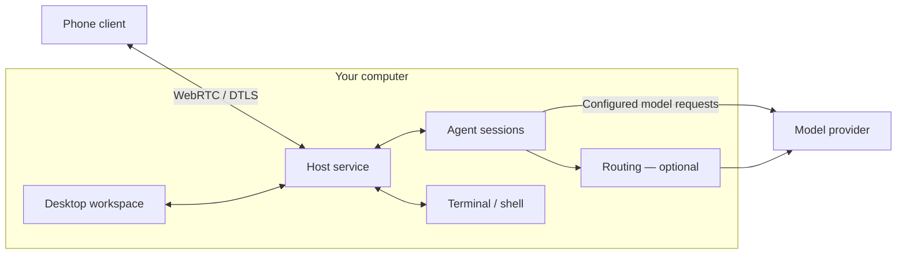

<picture><source media="(prefers-color-scheme: dark)" srcset="assets/ping4u-logo-dark.svg"></picture>

# Ping4U

**Coding agents and terminals. On your machine. From your desk or your phone.**

A local agent is working through a task; you do not have to stay at your desk. Step away and use your phone to check progress, send a follow-up or run a command in an authorized terminal—the work still runs on your computer.

Ping4U organizes Claude Code, Codex, OpenCode and terminal sessions by project. Agents and shells run on your **Host computer**. A paired phone lets you start new work or continue an existing session. Built-in, optional **Routing (model routing and multi-account management)** configures account and model connections for supported tools.

[Download](https://ping4u.cc/downloads) · [Website](https://ping4u.cc/) · [Getting started](docs/getting-started.md) · [简体中文](README.zh-CN.md)

**Platforms:** macOS / Windows desktop Hosts; iOS / Android mobile clients. See [Downloads](https://ping4u.cc/downloads) for installation options and available releases.

## See it in action

The demo moves from a desktop coding session through Routing configuration to a phone follow-up on a webpage change. The phone sends the next instruction; the agent still runs on the Host.

[Watch the full 60-second demo](assets/ping4u-demo.mp4). The GIF is a 15-second edit of three workflow segments.

## Start with one project

1. **[Install Ping4U](https://ping4u.cc/downloads)** on your computer and sign in.
2. **Check Agent Management.** Select an installed, authenticated agent supported by your Ping4U release.
3. **Open a project and create a session.** Try: `Explain this project's directory structure. Do not change files.`
4. **Open a terminal** in the project when you need shell commands, build output or a test run. Check the working directory before executing commands.
5. **Continue from your phone, optionally.** Install the mobile app, generate a code in desktop **Phone Connection**, enter it on the phone, and approve the device on the Host. Open the session you just created and send a follow-up.

Signing in authenticates your Ping4U account and associates the Host with it, including attribution of relay usage. Agent sign-in and model-service authorization remain separate.

Already have a working agent configuration? Start there. Configure Routing when you need to manage supported accounts and models. [Full setup guide →](docs/getting-started.md)

## How it works

**Execution stays on the Host.** The project directory, agent processes and shells live on your computer. The phone sends actions and receives conversation content or terminal state. Keep the Host awake, connected and running for remote access.

**Agent sessions and terminals are separate ways to work.** Use an agent conversation for a coding task and a terminal for shell commands. A project groups that work; it does not merge the agents' conversation histories.

**Routing is optional.** It configures model access for compatible tools. Model requests may go to the agent's configured provider directly or through Routing. Applying a configuration and completing a model request are separate steps.

## Integrations and boundaries

| Area | What to expect |
|---|---|
| Agents | Claude Code, Codex and OpenCode integrations; supported versions and features depend on the installed release. Check Agent Management. |
| Context | Continue the original session to keep its conversation. A new session or a different agent has its own context. |
| Terminal | A shell running on the Host, using its files, tools and environment. Phone input requires the corresponding Host permission. |
| Model access | Use your configured provider or compatible Routing connections. Agent authentication, provider limits and model charges still apply. |
| Remote access | Pair with the Host and approve access there. Phone connectivity does not move execution to the phone or keep a sleeping Host available. |
| Source | Ping4U is closed source. This repository contains public documentation and demo media. |

## Privacy and security

Phone-to-Host application traffic uses WebRTC with DTLS protection and signed signaling. Model requests are a separate connection: providers may receive prompts, relevant code and tool output. Ping4U also includes low-volume startup and usage analytics.

Read [Privacy & security](docs/privacy-security.md) for connection metadata, local credential storage, analytics fields and controls, and the limits of transport encryption.

## Docs and feedback

- [Getting started](docs/getting-started.md) — agents, terminals, Routing and phone pairing.
- [Privacy & security](docs/privacy-security.md) — data handling and trust boundaries.
- [Issues](https://github.com/l0vest0rm/ping4u/issues) — bugs and feature requests.

For a bug report, include Ping4U and agent versions, Host/phone operating systems, reproduction steps, and expected versus actual behavior. Remove credentials, pairing codes and private content from logs and screenshots. Do not publish vulnerability exploit details in a public issue.
