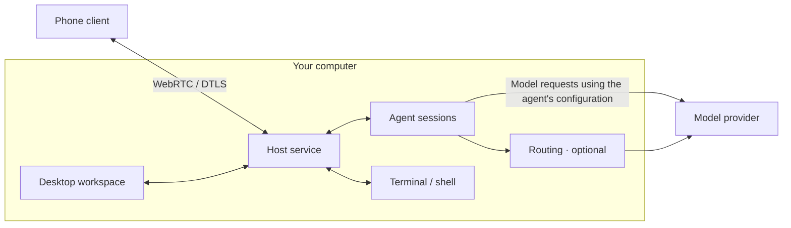

<picture><source media="(prefers-color-scheme: dark)" srcset="assets/ping4u-logo-dark.svg"></picture>

# Ping4U

 

**Run coding agents and terminals on your computer. Work from your desk or your phone.**

When a local agent is working through a task, you can step away from your desk. Use your phone to check progress, send a follow-up, or run a command in a terminal you've been granted access to. The task keeps running on the same computer.

Ping4U groups Claude Code, Codex, OpenCode, and terminal sessions by project. Agents and shells run on your **host machine**. Pair a phone to start new tasks or resume existing sessions. Enable **Routing** if you want to manage multiple accounts and configure model access for supported tools.

[Download](https://ping4u.cc/downloads) · [Website](https://ping4u.cc/) · [Getting started](docs/getting-started.md) · [中文](README.zh-CN.md)

**Platforms:** macOS and Windows hosts; iOS and Android clients. See [Downloads](https://ping4u.cc/downloads) for installation options and available releases.

## Why Ping4U

- **A Rust + GPUI desktop workspace.** The main desktop interface is written in Rust, compiled to native code, and rendered with GPUI. Some management pages use the system WebView.
- **A 58.5 MB macOS download.** The v0.19.0 Apple Silicon DMG is 58,488,173 bytes. This is the compressed installer size; installed disk usage differs. See [Downloads](https://ping4u.cc/downloads) for other platforms and newer versions.
- **Step away and keep working on the same task.** Pair your phone to check progress, send a follow-up, or use an authorized terminal with the project files, tools, and environment on your host.
- **Free to use, with no software or relay fees.** Model requests use your own provider account. Its quotas and charges still apply.

## See it in action

The demo starts with a coding session on the desktop, shows how to configure Routing, and ends with a follow-up from the phone asking the agent to adjust a web page. The phone sends the instruction; the agent carries it out on the host.

[Watch the full 60-second demo](assets/ping4u-demo.mp4). The GIF shows three excerpts in 15 seconds.

## Start with one project

1. **[Install Ping4U](https://ping4u.cc/downloads).** Open the desktop app and sign in.
2. **Check Agent Management.** Choose an agent that is installed, signed in, and supported by your version of Ping4U.
3. **Open a project and start a session.** Try: `Explain this project's directory structure. Do not change any files.`
4. **Open a terminal when you need a shell.** Run commands, inspect build output, or run tests. Check the working directory before running commands.
5. **Continue from your phone when you need to.** Install the mobile app, generate a pairing code under **Phone Connection** on the desktop, enter it on the phone, and approve the device on the host. Open the session you started and send a follow-up.

Signing in authenticates your Ping4U account, binds devices to it, and manages relay connections. Relays forward traffic when a direct peer-to-peer connection is restricted. Ping4U does not charge relay fees. Sign in to each agent and authorize model providers separately.

If your agent is already configured, you can start with that setup. Enable Routing when you need to manage accounts and models. [Read the full setup guide →](docs/getting-started.md)

## How it works

**Tasks run on the host.** Your project files, agent processes, and shells stay on your computer. The phone sends input and receives conversation content or terminal state. For remote access, keep the host awake and online, with the host service running.

**Agent conversations and terminals are separate.** Use a conversation for coding tasks and a terminal for shell commands. A project groups both kinds of work. Ping4U does not merge conversation histories across agents.

**Routing is optional.** It configures model access for compatible tools. Agents can send model requests to their configured provider directly or through Routing. After applying a configuration, send a model request to verify that it works.

## Integrations and limits

| Area | What to expect |
|---|---|
| Agents | Integrations include Claude Code, Codex, and OpenCode. Supported versions and features depend on the installed release. Check Agent Management. |
| Session context | Resume an existing session to keep its conversation. New sessions and sessions with a different agent have separate context. |
| Terminal | The shell runs on the host and uses its files, tools, and environment. Entering commands from a phone requires permission from the host. |
| Model access | Use the agent's configured provider or a compatible Routing connection. Agent sign-in requirements, provider limits, and model charges still apply. |
| Remote access | After pairing, approve access on the host. The phone does not run the task locally, wake a sleeping host, or keep it reachable while it sleeps. |
| Source | Ping4U is distributed as a closed-source application. This repository contains public documentation and demo media. |

## Privacy and security

Application data between the phone and host travels over WebRTC with DTLS and signed signaling. Model requests use a separate connection: providers may receive prompts, relevant code, and tool output. Ping4U also collects low-volume startup and usage analytics.

See [Privacy & security](docs/privacy-security.md) for details on connection metadata, local credential storage, analytics fields and controls, and what transport encryption covers.

## Docs and feedback

- [Getting started](docs/getting-started.md): Agents, terminals, Routing, and phone pairing.
- [Privacy & security](docs/privacy-security.md): Data handling and trust boundaries.
- [Issues](https://github.com/l0vest0rm/ping4u/issues): Bug reports and feature requests.

Star this repository to find it again when you're ready to try Ping4U. Share bugs and feature requests in Issues.

When reporting a bug, include your Ping4U and agent versions, host and phone operating systems, steps to reproduce, and what you expected versus what happened. Remove credentials, pairing codes, and private content from logs and screenshots. Do not publish vulnerability exploit details in public issues.
