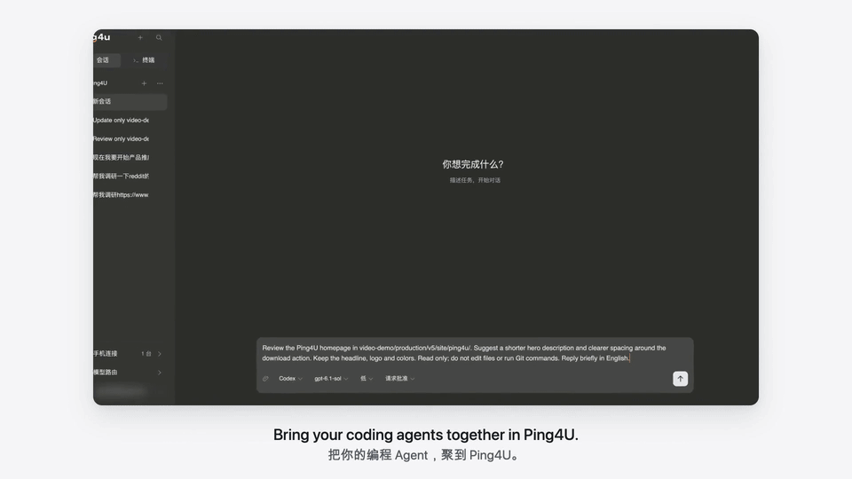

<picture><source media="(prefers-color-scheme: dark)" srcset="assets/ping4u-logo-dark.svg"></picture>

# Ping4U

**Your agents. Your models. One workspace.**

Ping4U brings coding-agent sessions and real terminals into a project workspace. Work on your computer, or connect your phone to start and continue work on the same Host. Optional Routing manages account and model connections for supported tools.

[Website](https://ping4u.cc/) · [Downloads](https://ping4u.cc/downloads) · [Getting started](docs/getting-started.md) · [Privacy & security](docs/privacy-security.md) · [简体中文](README.zh-CN.md)

*See the desktop, Routing and phone workflow in this 15-second preview. [Watch the full 60-second demo](assets/ping4u-demo.mp4).*

## What you can do

- **Organize work by project.** Keep coding-agent sessions and terminals accessible from one workspace.
- **Choose a coding agent.** Integrations include Claude Code, Codex and OpenCode, subject to the supported versions and capabilities in your installed release.
- **Use a real terminal.** Commands run on your Host computer, in its project directories and environment.
- **Connect a phone when needed.** Start a session, continue a conversation or use an authorized terminal on the Host. Desktop use does not require a phone.
- **Configure model access with Routing.** Manage supported accounts and models for compatible tools. Routing is optional; configuration support varies by tool and provider.

## A typical workflow

Open a project, ask one agent to review a change, and use another session for implementation. Open a terminal for commands when needed. Away from your desk, connect your phone and continue a Ping4U-managed session on the Host.

Each agent session has its own context. Switching agents does not automatically transfer a conversation or share its history.

## Start here

1. [Download Ping4U](https://ping4u.cc/downloads) for your computer and follow the installation instructions.
2. Open Ping4U, complete sign-in, and check your installed tools in Agent Management.
3. Select a project and a supported agent, then start a task. Configure Routing if you need it.
4. Optionally install the mobile app from the download page and pair it through Phone Connection.

See the [setup guide](docs/getting-started.md) for details.

## Where work runs

Agents and terminal processes run on the Host. Your phone is a client of that workspace. Keep the Host computer awake, its service running and its network connected for remote access.

An agent may send prompts, relevant code and tool output to its configured model provider. Encrypted phone-to-Host transport does not make those separate model requests private from that provider. Read the [privacy and security notes](docs/privacy-security.md).

## About this repository

This is the official repository for Ping4U product documentation and demos. Ping4U is a closed-source application.

[Open an issue](https://github.com/l0vest0rm/ping4u/issues) to report a problem or suggest an improvement. For a problem report, include the Ping4U version, Host and phone operating systems, agent version, steps and observed result. Remove credentials, pairing codes, private code and personal information before sharing logs or screenshots. Do not post vulnerability details in a public issue.
