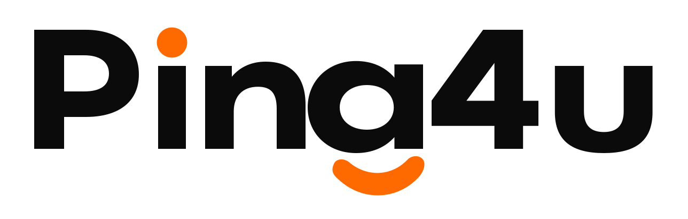
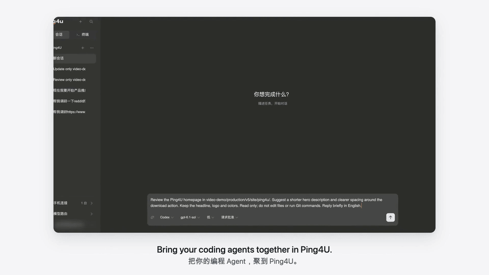
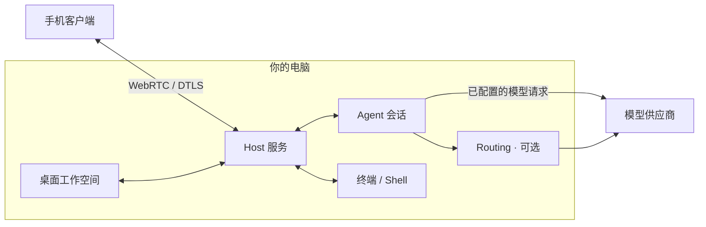

<picture><source media="(prefers-color-scheme: dark)" srcset="assets/ping4u-logo-dark.svg"></picture>

# Ping4U

 

**Agent 和终端在你的电脑上运行，电脑、手机都能继续工作。**

本地 Agent 跑着任务，你不必一直守在工位。离开电脑后，用手机查看进度、追加指令，或在已授权的终端中执行命令；任务仍在原来的电脑上运行。

Ping4U 把多个编码 Agent 和终端会话组织进同一个项目工作区。Agent 与 Shell 运行在你的 **Host 电脑**上，配对后的手机可以发起新任务，也可以继续已有会话。内置可选的 **Routing（模型路由与多账号管理）**，用于为受支持的工具配置账号与模型。

[下载](https://ping4u.cc/downloads) · [官网](https://ping4u.cc/) · [快速开始](docs/getting-started.md) · [English](README.md)

**支持平台：** 桌面 Host 为 macOS / Windows；移动客户端为 iOS / Android。安装方式与可下载版本见[下载页](https://ping4u.cc/downloads)。

**Agent 接入：** Claude Code · Codex · OpenCode · Pi · WorkBuddy · DeepSeek Harness

## 为什么用 Ping4U

- **Rust + GPUI 桌面工作空间。** 桌面主界面使用 Rust 编写，编译为原生代码，由 GPUI 渲染；部分管理页面使用系统 WebView。
- **macOS 下载包 58.5 MB。** Apple Silicon v0.19.0，DMG 格式。[下载安装 →](https://ping4u.cc/downloads)
- **6 种 Agent，同一个工作区。** 按项目管理不同工具的会话和终端，复用本机已有的 Agent 配置。
- **离开工位，继续同一个任务。** 手机配对后可查看进度、追加指令或操作已授权的终端，继续使用 Host 上的项目文件、工具和环境。
- **免费使用，软件与中继均不收费。** 模型调用仍使用你自己的供应商账号，额度与费用由该账号承担。

## 看一次实际操作

演示从桌面编程会话开始，经过 Routing 配置，再从手机追加网页修改要求。手机发送下一条指令，Agent 仍在 Host 上执行。

[观看 60 秒完整演示](assets/ping4u-demo.mp4)。GIF 是三个操作片段剪辑而成的 15 秒预览。

## 从一个项目开始

1. **[安装 Ping4U](https://ping4u.cc/downloads)**，打开桌面端并登录。
2. **检查「Agent 管理」。** 选择已经安装、登录，且受当前 Ping4U 版本支持的 Agent。
3. **打开项目，新建会话。** 可以先发送：`解释这个项目的目录结构，先不要修改文件。`
4. **需要命令时打开终端。** 在项目中运行 Shell 命令、查看构建输出或执行测试；执行前先确认当前目录。
5. **需要时从手机继续。** 安装手机 App，在桌面「手机连接」中生成配对码，手机输入后由 Host 确认设备。打开刚才的会话，追加一条指令。

Ping4U 登录用于账号认证、设备绑定和中继连接管理。P2P 直连受限时，中继服务负责转发流量，Ping4U 不收取中继费用。各 Agent 的登录与模型供应商授权仍需分别完成。

已有可用的 Agent 配置，可以直接开始。有账号与模型管理需求时再配置 Routing。[查看完整使用指南 →](docs/getting-started.md)

## 它如何工作

**执行环境在 Host 上。** 项目目录、Agent 进程和 Shell 都在电脑上。手机发送操作，接收会话内容或终端状态。远程访问时，需要保持 Host 唤醒、服务运行和网络连接。

**Agent 会话与终端是两种工作入口。** 用 Agent 对话推进编程任务，用终端执行 Shell 命令。项目把这些工作组织起来，但不会合并不同 Agent 的对话历史。

**Routing 按需使用。** 它为兼容的工具配置模型接入。模型请求可以直接使用 Agent 已配置的供应商，也可以经过 Routing。应用配置后，仍需用实际请求确认接入成功。

## 接入范围与边界

| 部分 | 实际行为 |
|---|---|
| Agent | 接入 Claude Code、Codex、OpenCode、Pi、WorkBuddy、DeepSeek Harness；版本与功能支持取决于当前发行版，可在「Agent 管理」中检查。 |
| 上下文 | 继续原会话可以保留该对话；新建会话或切换 Agent，各有独立上下文。 |
| 终端 | Shell 在 Host 上运行，使用电脑的文件、工具和环境；手机输入需要 Host 授予对应权限。 |
| 模型接入 | 使用已配置的供应商，或兼容的 Routing 接入。Agent 登录、供应商额度和模型费用仍分别适用。 |
| 远程访问 | 配对后由 Host 确认权限。手机连接不会把执行环境迁到手机，也不能让休眠的 Host 继续提供访问。 |
| 源码 | Ping4U 为闭源应用，本仓库提供公开文档和演示素材。 |

## 隐私与安全

手机与 Host 的业务数据通过 WebRTC 传输，使用 DTLS 保护和签名信令。模型请求是另一条连接：供应商可能收到提示词、相关代码和工具输出。Ping4U 也包含低频的启动与使用统计。

连接元数据、本地凭据存储、统计字段与控制方式，以及传输加密的保护边界，见[隐私与安全说明](docs/privacy-security.md)。

## 文档与反馈

- [快速开始](docs/getting-started.md)：Agent、终端、Routing 与手机配对。
- [隐私与安全](docs/privacy-security.md)：数据处理范围与信任边界。
- [Issues](https://github.com/l0vest0rm/ping4u/issues)：问题反馈与功能建议。

想稍后试用，可以 Star 收藏本仓库。试用后的问题与建议欢迎提交到 Issues。

报告问题时，请附上 Ping4U 和 Agent 版本、电脑与手机系统、复现步骤、预期结果和实际结果。日志和截图中请移除密钥、配对码与私有内容，不要在公开 Issue 中发布安全漏洞利用细节。
